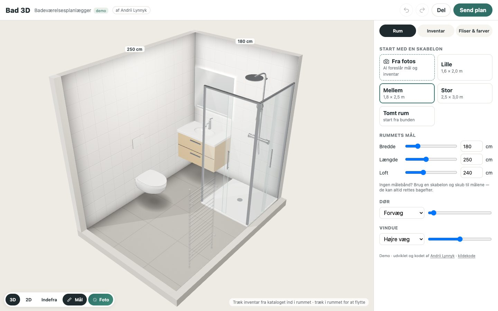

# Bad 3D — bathroom planner in the browser

**Author: Andrii Lynnyk** ([andrii.dk](https://andrii.dk/) · [github.com/andrey-tut](https://github.com/andrey-tut)) — idea, research, UX, 3D models, code and AI pipeline. October 2026.

- **Project page:** https://andrey-tut.github.io/bathroom-planner/
- **Live in production at a client:** https://badova.dk/planner/ (Danish bathroom renovation company)

Photos of the old bathroom → AI reads layout, proportions, doors, windows and plumbing → the planner builds the renovated room in 3D (own parametric models, procedural tiles in real centimetres, placement rules, 2D plan, eye-level view, PWA).

This repository holds only the project page. The source code is private and proprietary; client sites get the planner as a licensed service through an integration key. Licensing and demos: [andrii.dk](https://andrii.dk/).

© 2026 Andrii Lynnyk. All rights reserved.
